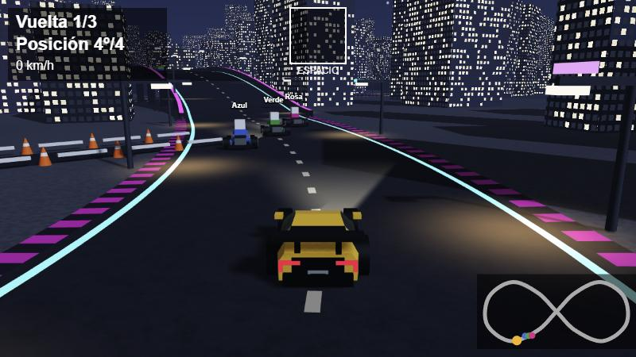
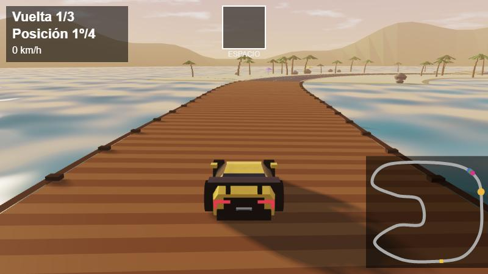
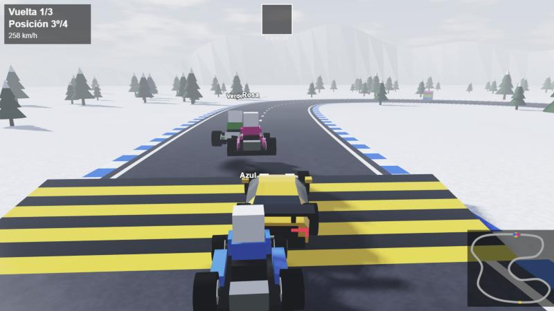
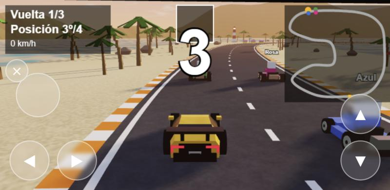
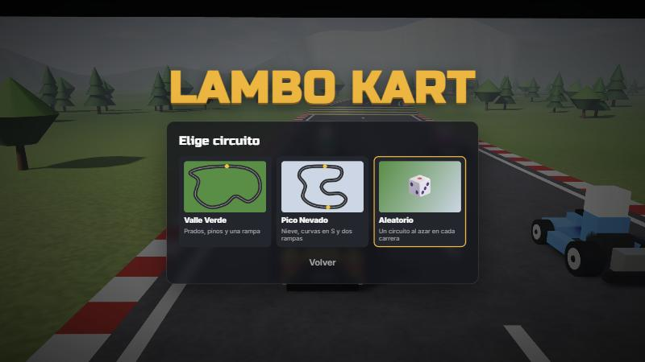
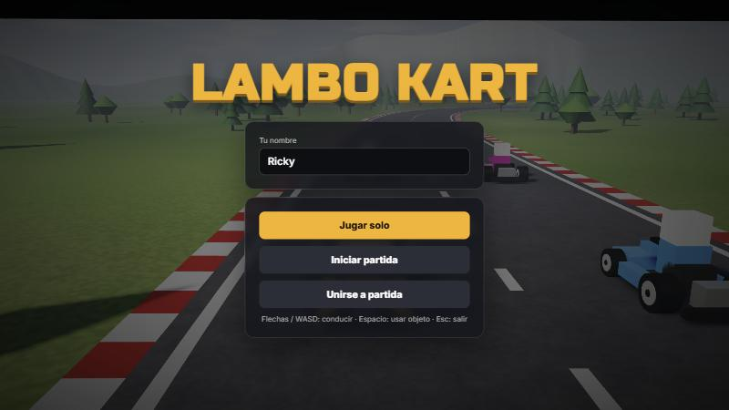
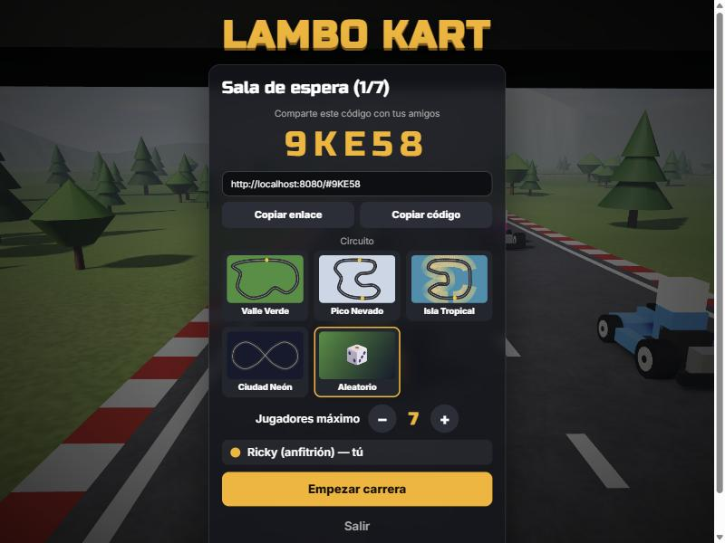
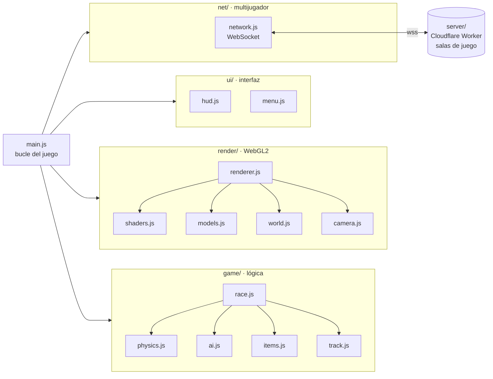

<div align="center">

# 🏎️ Lambo Kart

**Juego de carreras 3D en el navegador, con multijugador online y gráficos hechos desde cero con WebGL2.**

[](https://rickyrdguez.github.io/Lambo-kart/)




</div>

## ✨ Características

- 🎮 **Estilo Mario Kart**: 3 vueltas, cajas sorpresa con **turbo** y **plátanos**, marcador de posición, minimapa y clasificación final.
- 🗺️ **Cuatro circuitos con ambientación propia**, a elegir antes de cada carrera (o 🎲 *Aleatorio*; en multijugador elige el anfitrión):
  - *Valle Verde*: prados, pinos y una rampa.
  - *Pico Nevado*: nieve, curvas en S, pinos nevados y dos rampas.
  - *Isla Tropical*: atardecer junto al mar, **muelle de madera** (si te sales, al agua), **salto sobre una cala** con placa de turbo, **atajo de arena** entre palmeras y un arco de roca.
  - *Ciudad Neón*: de noche, trazado en 8 con un **puente** que cruza por encima de la propia pista, **túnel**, **callejón** con conos, rascacielos con ventanas encendidas, neones, farolas, faros, luna y estrellas.
- 🛫 **Rampas con salto**: el coche vuela con física de gravedad, se inclina en el aire y gana un mini-turbo al aterrizar.
- 📱 **Se juega en el móvil**: botones táctiles en pantalla (girar, acelerar/frenar y usar objeto), pantalla completa en horizontal y gráficos adaptados. En el ordenador no aparecen.
- 🌍 **Multijugador online de 2 a 7 jugadores**: se crea una sala con un código de 5 letras o un enlace de invitación, y el anfitrión elige cuántos caben, como en Among Us. Si sois menos de 4, karts con IA completan la parrilla. Funciona desde cualquier red, incluidas las de universidad y los datos móviles, gracias a un servidor de reenvío propio en **Cloudflare Workers**.
- 🎨 **Motor gráfico propio con WebGL2**, sin Three.js ni otros motores:
  - Sombras en tiempo real (*shadow mapping* con filtrado PCF)
  - Reflejos del cielo con efecto Fresnel en la pintura, los cristales y el cromo
  - Cielo con nubes procedurales, niebla atmosférica y *tone mapping* ACES
  - Asfalto, hierba, nieve y arena con texturas generadas por ruido en el shader
  - Mar animado con olas, reflejos del cielo y destellos del sol
  - Noche: ventanas procedurales, luces de farolas y faros como "charcos de luz" aditivos, luna y estrellas
- 🚗 **Modelos 3D generados por código**: el Lamborghini, los karts, los árboles y las montañas se construyen a partir de secciones y formas geométricas.
- 🤖 **IA de los rivales** que sigue la trazada y ajusta su ritmo para que la carrera esté igualada (*rubber banding*).
- 📦 **Cero dependencias de desarrollo**: JavaScript moderno con módulos ES, sin *bundler* ni paso de compilación.

<table>
  <tr>
    <td></td>
    <td></td>
  </tr>
  <tr>
    <td align="center"><sub>Muelle sobre el mar en Isla Tropical</sub></td>
    <td align="center"><sub>Rampa con salto en Pico Nevado</sub></td>
  </tr>
  <tr>
    <td></td>
    <td></td>
  </tr>
  <tr>
    <td align="center"><sub>En el móvil, con controles táctiles</sub></td>
    <td align="center"><sub>Elegir circuito o aleatorio</sub></td>
  </tr>
  <tr>
    <td></td>
    <td></td>
  </tr>
  <tr>
    <td align="center"><sub>Menú principal</sub></td>
    <td align="center"><sub>Sala de espera: código para invitar y elección de circuito</sub></td>
  </tr>
</table>

## 🕹️ Controles

| Tecla | Acción |
|:---:|---|
| `↑` `W` | Acelerar |
| `↓` `S` | Frenar / marcha atrás |
| `←` `→` `A` `D` | Girar |
| `Espacio` | Usar objeto |
| `Esc` | Online: el anfitrión lleva a todos a la sala de espera (el grupo sigue junto); un invitado sale de la partida. Solo: elegir circuito |
| `Enter` | Otra carrera con el mismo grupo (anfitrión, al terminar) |

En el **móvil** (en horizontal): ◀ ▶ abajo a la izquierda para girar (se puede deslizar el pulgar de uno a otro), pedales abajo a la derecha (▲ acelerar, ▼ frenar) y el botón de objeto encima de ◀ ▶. En iPhone, para jugar a pantalla completa: **Compartir → Añadir a pantalla de inicio**.

## 👥 Jugar con amigos

1. Abre el juego y pulsa **Iniciar partida**.
2. Comparte el **código** o pulsa **Copiar enlace** y envíalo.
3. Tus amigos abren el enlace (o pulsan **Unirse a partida** y escriben el código).
4. Elige el circuito (o *Aleatorio*) y el número máximo de jugadores (de 2 a 7) y, cuando estéis todos en la sala, pulsa **Empezar carrera**.

## 🏗️ Arquitectura

El código está dividido en módulos ES con una responsabilidad clara cada uno:



```
├── index.html            Página y menús
├── src/
│   ├── main.js           Punto de entrada y bucle principal
│   ├── config.js         Ajustes (vueltas, colores, cámara, luz, red)
│   ├── styles.css        Estilos del menú
│   ├── core/             Matemáticas: vectores, ángulos y matrices 4x4
│   ├── game/             Circuitos, pista, coches, física y saltos, IA, objetos, reglas de carrera
│   ├── render/           Motor WebGL2: shaders, modelos, escenario y cámara
│   ├── ui/               Marcador (canvas 2D), menú (HTML) y controles táctiles
│   └── net/              Multijugador online
├── server/               Servidor de reenvío (Cloudflare Workers + Durable Objects)
├── tools/dev-server.js   Servidor local sin dependencias
└── docs/                 Capturas y documentación técnica
```

Cómo funcionan el render en tres pasadas, la física y la sincronización online: **[docs/ARQUITECTURA.md](docs/ARQUITECTURA.md)**.

## 🚀 Ejecutarlo en local

Requiere [Node.js](https://nodejs.org/) (solo para servir los archivos; no se instala nada).

```bash
git clone https://github.com/Rickyrdguez/Lambo-kart.git
cd Lambo-kart
npm start
```

Abre **http://localhost:8080**. Los módulos ES necesitan servirse por `http`, por eso no basta con abrir `index.html` con doble clic.

## 🛠️ Tecnologías

| | |
|---|---|
| **Lenguaje** | JavaScript (ES2022, módulos ES), HTML, CSS |
| **Gráficos 3D** | WebGL2 y GLSL ES 3.0 |
| **Interfaz** | Canvas 2D para el marcador, HTML/CSS para los menús |
| **Red** | WebSocket seguro con un servidor propio en Cloudflare Workers + Durable Objects |
| **Publicación** | GitHub Pages (juego) y Cloudflare (servidor) |

## 📄 Licencia

[MIT](LICENSE) © Rickyrdguez

<sub>Desarrollado con ayuda de Claude (Anthropic).</sub>
