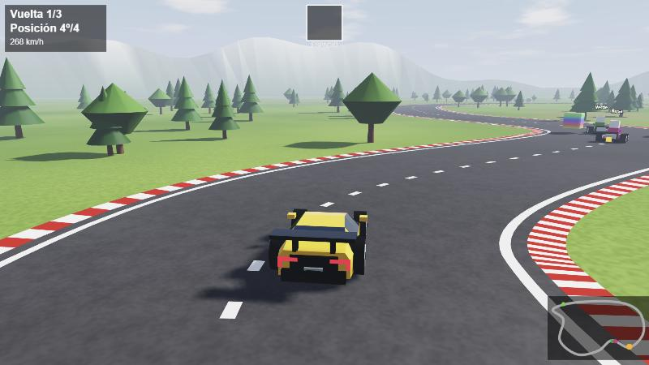
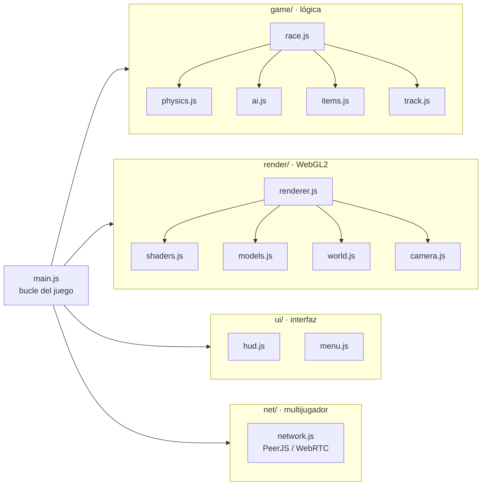

<div align="center">

# 🏎️ Lambo Kart

**Juego de carreras 3D en el navegador, con multijugador online y gráficos hechos desde cero con WebGL2.**

[](https://rickyrdguez.github.io/Lambo-kart/)




</div>

## ✨ Características

- 🎮 **Estilo Mario Kart**: 3 vueltas, cajas sorpresa con **turbo** y **plátanos**, marcador de posición, minimapa y clasificación final.
- 🌍 **Multijugador online de hasta 4 jugadores**: se crea una sala con un código de 5 letras o un enlace de invitación. Los huecos libres los ocupan karts con IA.
- 🎨 **Motor gráfico propio con WebGL2**, sin Three.js ni otros motores:
  - Sombras en tiempo real (*shadow mapping* con filtrado PCF)
  - Reflejos del cielo con efecto Fresnel en la pintura, los cristales y el cromo
  - Cielo con nubes procedurales, niebla atmosférica y *tone mapping* ACES
  - Asfalto y hierba con texturas generadas por ruido en el shader
- 🚗 **Modelos 3D generados por código**: el Lamborghini, los karts, los árboles y las montañas se construyen a partir de secciones y formas geométricas.
- 🤖 **IA de los rivales** que sigue la trazada y ajusta su ritmo para que la carrera esté igualada (*rubber banding*).
- 📦 **Cero dependencias de desarrollo**: JavaScript moderno con módulos ES, sin *bundler* ni paso de compilación.

<table>
  <tr>
    <td></td>
    <td></td>
  </tr>
  <tr>
    <td align="center"><sub>Menú principal</sub></td>
    <td align="center"><sub>Sala de espera con código para invitar</sub></td>
  </tr>
</table>

## 🕹️ Controles

| Tecla | Acción |
|:---:|---|
| `↑` `W` | Acelerar |
| `↓` `S` | Frenar / marcha atrás |
| `←` `→` `A` `D` | Girar |
| `Espacio` | Usar objeto |
| `Esc` | Salir al menú |
| `Enter` | Otra carrera (anfitrión, al terminar) |

## 👥 Jugar con amigos

1. Abre el juego y pulsa **Iniciar partida**.
2. Comparte el **código** o pulsa **Copiar enlace** y envíalo.
3. Tus amigos abren el enlace (o pulsan **Unirse a partida** y escriben el código).
4. Cuando estéis todos en la sala, pulsa **Empezar carrera**.

## 🏗️ Arquitectura

El código está dividido en módulos ES con una responsabilidad clara cada uno:



```
├── index.html            Página y menús
├── src/
│   ├── main.js           Punto de entrada y bucle principal
│   ├── config.js         Ajustes (vueltas, colores, cámara, luz, red)
│   ├── styles.css        Estilos del menú
│   ├── core/             Matemáticas: vectores, ángulos y matrices 4x4
│   ├── game/             Pista, coches, física, IA, objetos, reglas de carrera
│   ├── render/           Motor WebGL2: shaders, modelos, escenario y cámara
│   ├── ui/               Marcador (canvas 2D) y menú (HTML)
│   └── net/              Multijugador online
├── tools/dev-server.js   Servidor local sin dependencias
└── docs/                 Capturas y documentación técnica
```

Cómo funcionan el render en tres pasadas, la física y la sincronización online: **[docs/ARQUITECTURA.md](docs/ARQUITECTURA.md)**.

## 🚀 Ejecutarlo en local

Requiere [Node.js](https://nodejs.org/) (solo para servir los archivos; no se instala nada).

```bash
git clone https://github.com/Rickyrdguez/Lambo-kart.git
cd Lambo-kart
npm start
```

Abre **http://localhost:8080**. Los módulos ES necesitan servirse por `http`, por eso no basta con abrir `index.html` con doble clic.

## 🛠️ Tecnologías

| | |
|---|---|
| **Lenguaje** | JavaScript (ES2022, módulos ES), HTML, CSS |
| **Gráficos 3D** | WebGL2 y GLSL ES 3.0 |
| **Interfaz** | Canvas 2D para el marcador, HTML/CSS para los menús |
| **Red** | WebRTC mediante [PeerJS](https://peerjs.com/) |
| **Publicación** | GitHub Pages |

## 📄 Licencia

[MIT](LICENSE) © Rickyrdguez

<sub>Desarrollado con ayuda de Claude (Anthropic).</sub>
