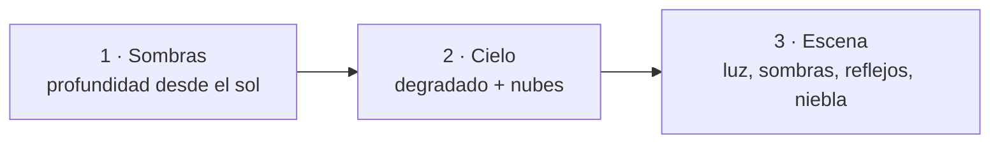
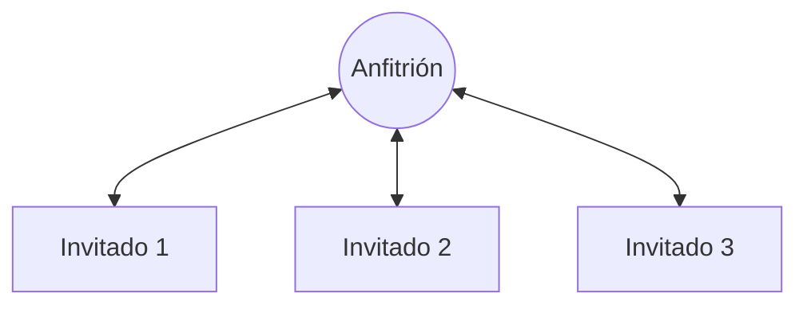

# Arquitectura de Lambo Kart

Este documento explica cómo funciona el juego por dentro. Cada apartado indica en qué archivo está el código.

## Bucle principal

[`src/main.js`](../src/main.js) ejecuta en cada fotograma (`requestAnimationFrame`):

1. `updateRace(dt)`: física, IA, objetos y vueltas.
2. `netTick(t)`: envía el estado por red, si se juega online.
3. `updateCamera(dt)`: la cámara sigue al coche con un pequeño retraso.
4. `render(t)`: dibuja la escena 3D con WebGL2.
5. `renderHUD()`: dibuja el marcador en un canvas 2D superpuesto.

`dt` mide el tiempo transcurrido en fotogramas de 60 fps (1 = un fotograma), así el juego va igual de rápido a 30, 60 o 144 fps.

## Pista y mundo de juego

- **Trazado** ([`game/track.js`](../src/game/track.js)): una curva Catmull-Rom cerrada pasa por 11 puntos de control y se divide en 440 puntos. Cada punto guarda su dirección (`a`).
- **Coordenadas**: la lógica del juego es 2D (`x`, `y` del mapa). Al dibujar, `y` se convierte en el eje `Z` del espacio 3D y la altura es `Y`.
- **Progreso**: el *segmento* de un coche es el punto de la pista más cercano. Para que sea rápido, solo se busca cerca del último segmento conocido. Una vuelta se cuenta cuando el segmento salta del final al principio de la pista.

## Física e IA

- **Física arcade** ([`game/physics.js`](../src/game/physics.js)): aceleración, rozamiento y velocidad máxima, que baja fuera de la pista. El giro depende de la velocidad. Los choques entre coches se resuelven separando los círculos que se solapan.
- **IA** ([`game/ai.js`](../src/game/ai.js)): cada kart apunta a un punto de la pista unos segmentos por delante, en su propio carril, y frena si el ángulo de giro es muy grande. Con el *rubber banding*, la IA acelera un poco si va detrás del jugador que va primero y frena si va delante.

## Render (WebGL2)

### Geometría

Los modelos se generan por código en [`render/models.js`](../src/render/models.js) y [`render/world.js`](../src/render/world.js). La pieza clave es `loft()` ([`render/geometry.js`](../src/render/geometry.js)): une una serie de **secciones transversales** colocadas a lo largo del coche. El Lamborghini son 8 secciones hexagonales que forman su silueta en cuña.

Cada vértice ocupa 12 números: posición, normal, color, uv y **material**. El material es un número que el shader usa para cambiar de aspecto: pintura, cristal, cromo, asfalto, hierba, emisivo…

### Tres pasadas por fotograma ([`render/renderer.js`](../src/render/renderer.js))

1. **Mapa de sombras**: se dibujan los coches, árboles y objetos desde el punto de vista del sol en una textura de profundidad de 2048×2048. La zona cubierta sigue al jugador y se ajusta a una rejilla para que las sombras no tiemblen.
2. **Cielo**: un único triángulo que cubre la pantalla. Para cada píxel se calcula la dirección de la mirada, y con ella el degradado, el sol y unas nubes de ruido fractal (fbm).
3. **Escena** ([`render/shaders.js`](../src/render/shaders.js)):
   - Iluminación difusa del sol más luz ambiente de cielo y suelo (*hemispheric lighting*).
   - Sombra filtrada con 9 muestras (PCF).
   - Brillo especular Blinn-Phong y reflejo del cielo con aproximación de **Fresnel-Schlick**.
   - Texturas procedurales de ruido para el asfalto y la hierba.
   - Niebla exponencial hacia el color del horizonte.
   - Todo el cálculo se hace en espacio lineal, y al final se aplican *tone mapping* **ACES** y corrección gamma.

## Multijugador ([`net/network.js`](../src/net/network.js))

Las conexiones son **WebRTC** entre navegadores, usando PeerJS. El servidor público de PeerJS solo sirve para la señalización: que los navegadores se encuentren a partir del código de la sala. Si la conexión directa no es posible, PeerJS usa servidores TURN.

### Topología en estrella

El anfitrión acepta las conexiones, asigna un hueco (0–3) a cada jugador y **reenvía** los mensajes de cada invitado al resto.

### Quién simula qué

| Lo simula | Qué | Se envía |
|---|---|---|
| Cada jugador | Su propio coche | `car` ~30 veces/s |
| Anfitrión | IA, cajas, plátanos y orden de llegada | `world` ~20 veces/s |

Como cada jugador simula su coche en su propio ordenador, conducir **no tiene retraso**. Los coches de los demás se dibujan con:

- **Predicción** (*dead reckoning*): la última posición recibida se avanza según su velocidad y dirección.
- **Interpolación**: el coche visible se acerca un 30 % a esa posición en cada fotograma, para que no dé saltos.

### Mensajes

| Mensaje | Dirección | Contenido |
|---|---|---|
| `hello` | invitado → anfitrión | Nombre del jugador |
| `welcome` | anfitrión → invitado | Hueco asignado |
| `lobby` | anfitrión → todos | Jugadores en la sala |
| `start` | anfitrión → todos | Empieza la carrera |
| `car` | cada jugador → todos | Posición, velocidad, vuelta y objeto de su coche |
| `world` | anfitrión → todos | Estado, IA, cajas, plátanos y llegada |
| `item` / `spin` | anfitrión → un jugador | Has cogido un objeto / has pisado un plátano |
| `banana` | invitado → anfitrión | He tirado un plátano |
| `full` | anfitrión → invitado | La sala está llena |

Si un jugador se desconecta a mitad de carrera, la IA pasa a conducir su coche.
