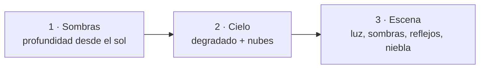
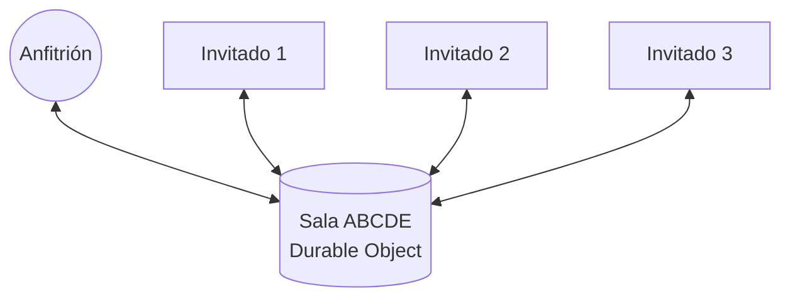

# Arquitectura de Lambo Kart

Este documento explica cómo funciona el juego por dentro. Cada apartado indica en qué archivo está el código.

## Bucle principal

[`src/main.js`](../src/main.js) ejecuta en cada fotograma (`requestAnimationFrame`):

1. `updateRace(dt)`: física, IA, objetos y vueltas.
2. `netTick(t)`: envía el estado por red, si se juega online.
3. `updateCamera(dt)`: la cámara sigue al coche con un pequeño retraso.
4. `render(t)`: dibuja la escena 3D con WebGL2.
5. `renderHUD()`: dibuja el marcador en un canvas 2D superpuesto.

`dt` mide el tiempo transcurrido en fotogramas de 60 fps (1 = un fotograma), así el juego va igual de rápido a 30, 60 o 144 fps.

## Pista y mundo de juego

- **Trazado** ([`game/track.js`](../src/game/track.js)): una curva Catmull-Rom cerrada pasa por 11 puntos de control y se divide en 440 puntos. Cada punto guarda su dirección (`a`).
- **Coordenadas**: la lógica del juego es 2D (`x`, `y` del mapa). Al dibujar, `y` se convierte en el eje `Z` del espacio 3D y la altura es `Y`.
- **Progreso**: el *segmento* de un coche es el punto de la pista más cercano. Para que sea rápido, solo se busca cerca del último segmento conocido. Una vuelta se cuenta cuando el segmento salta del final al principio de la pista.

## Circuitos ([`game/maps.js`](../src/game/maps.js))

Cada circuito es un objeto de datos:

- **`points`**: los puntos de control del trazado.
- **`ramps`**: los segmentos de la pista donde hay una rampa.
- **`theme`**: la ambientación. Incluye la dirección y el color del sol; los colores del cielo y del suelo; la densidad de la niebla y de las nubes; los colores del asfalto, los bordillos y las montañas; y el tipo y la cantidad de árboles.

Al cambiar de circuito, `loadMap()` ([`game/session.js`](../src/game/session.js)) reconstruye la pista y vuelve a generar el escenario en la GPU. Los colores del tema llegan a los shaders como *uniforms*, así que el mismo shader dibuja la hierba de *Valle Verde* y la nieve de *Pico Nevado*.

Para añadir un circuito nuevo basta con añadir otro objeto a `MAPS`. El menú lo muestra solo, con su miniatura dibujada a partir del trazado.

## Isla Tropical: agua, muelle, cala, atajo y placas de turbo

Los circuitos con `island` en su definición no tienen un suelo infinito: tienen **mar** (un plano de agua con su propio material en el shader) y una **franja de arena** a cada lado de la pista, de `radius` unidades de ancho.

- **Tierra y agua** ([`game/track.js`](../src/game/track.js)): al cargar el mapa, las franjas de tierra se rasterizan en una rejilla de celdas de 25 unidades (`buildLandMask`), así se puede preguntar al instante si un punto es tierra. Los tramos de `island.water` no tienen franja de tierra:
  - **Muelle (`pier`)**: la pista son tablones sobre el agua, sin bordillos.
  - **Cala (`cove`)**: no hay suelo; hay que saltarla con la rampa anterior.
- **Caer al agua** (`isWater` y [`game/race.js`](../src/game/race.js)):
  - Sobre la pista (asfalto o tablones) solo se puede caer en la cala. Fuera de la pista se consulta la rejilla.
  - Al caer, el coche se hunde poco a poco y reaparece: en la cala, al otro lado; en el resto, en el centro de la pista donde cayó.
- **Placas de turbo**: zonas sobre la pista que dan turbo al pasar. Hay una justo antes de la rampa de la cala para que el salto casi siempre llegue.
- **Atajo**: un segmento recto entre dos puntos de la pista, con suelo de arena compactada (un poco más lento que el asfalto). Mientras vas por él, tu progreso en la carrera se calcula a lo largo del atajo, así que las vueltas y las posiciones se siguen contando bien.
- **Mar animado** ([`render/shaders.js`](../src/render/shaders.js)): la normal del agua se ondula con varias ondas senoidales que cambian con el tiempo. El color mezcla el agua turquesa con el reflejo del cielo (Fresnel) y añade destellos del sol.

## Ciudad Neón: pista con altura, noche y luces

### Un puente que cruza la propia pista

El trazado es un **8**: la pista se cruza consigo misma en los segmentos 160 y 440. Cada punto de la pista tiene ahora una **altura** `h`. En `map.bridge` se define un tramo que sube suavemente (*smoothstep*), sigue recto a 100 de altura y vuelve a bajar.

- **¿Arriba o abajo?** La lógica del juego sigue siendo 2D, así que en el cruce dos tramos ocupan el mismo sitio en el mapa. Se distinguen porque `nearestSeg` solo busca **cerca del último segmento** de cada coche: el que va por abajo sigue en los segmentos ~160 y el que va por el puente en los ~440.
- **Altura del suelo** (`groundAt`): la altura de la calzada interpolada entre puntos, más la de una rampa si la hay. `updateHeight` ([`game/physics.js`](../src/game/physics.js)) mantiene el coche **pegado** al suelo mientras este suba o baje poco a poco (cuestas del puente). Si el suelo cae de golpe, como al final de una rampa, el coche sale volando con la velocidad vertical que llevaba.
- **Muros**: en los tramos elevados, `keepOnRoad` devuelve el coche a la calzada si llega al borde y lo endereza un poco, como si rozara el muro.
- **Objetos y coches a dos alturas**: las cajas y los plátanos guardan su altura `h`; solo afectan a coches a esa altura. Dos coches a distinta altura no chocan. La altura (`z` y `ground`) se envía por red.
- **Pilares**: se colocan bajo el puente salvo donde caerían encima de la pista de abajo.

### Un túnel bajo tierra con un parque encima

El túnel usa el mismo sistema de alturas, pero hacia abajo (`map.tunnel`): la pista baja por una **trinchera** hasta −90, pasa bajo tierra y vuelve a subir.

- **Agujero en el suelo**: el suelo de la ciudad ya no es una placa única, sino una rejilla de baldosas en la que se quitan las que caen sobre la trinchera. Los bordes dentados del agujero quedan tapados por las **aceras**.
- **Trinchera**: muros desde la calzada hasta el nivel de la calle, con un borde de neón. `keepOnRoad` también funciona aquí, igual que en el puente.
- **Túnel**: en el tramo cubierto hay un techo bajo el nivel de la calle, con tiras de luz y charcos de luz en el asfalto.
- **Parque**: encima, a nivel de calle, hay césped, un camino, árboles, bancos, farolitas y una fuente cuya agua usa el mismo material animado que el mar. Los edificios no se colocan sobre el parque ni sobre las aceras.

### Noche sin coste de luces dinámicas

- **Luna**: hace de "sol" (luz azulada y tenue, con sombras). Su disco es más grande gracias a `uDisc`. **Estrellas**: en el shader del cielo, la dirección de la mirada se divide en una rejilla y unas pocas celdas al azar se encienden. Es muy barato.
- **Ventanas**: material `WINDOWS`. Las uv de cada fachada cuentan ventanas, y el shader decide con un *hash* cuáles están encendidas. Miles de ventanas sin dibujar ninguna por separado.
- **Farolas y faros**: en vez de luces reales, se dibujan **"charcos de luz"** (círculos bajo las farolas y un cono delante de cada coche) que se **suman** a lo que hay debajo (*additive blending*). Queda casi igual y cuesta muy poco.
- **Bordes brillantes**: las líneas de la pista son emisivas para que se vea bien por dónde va la carretera.
- **Ambiente**: `uAmbient` baja la luz ambiente de noche.

## Móvil ([`ui/touch.js`](../src/ui/touch.js))

- Se detecta una pantalla táctil con `matchMedia('(pointer: coarse)')`. Solo entonces se muestran los botones y se añade la clase `touch` al `<body>`.
- **Conducción**: en cada evento táctil (`touchstart`, `touchmove`, `touchend`, `touchcancel`) se recorre la lista de **todos los dedos** y se mira qué botón tiene cada uno debajo, con un margen generoso. Con eso se marcan las mismas teclas que con el teclado. Ventajas:
  - Funcionan varios dedos a la vez.
  - Se puede deslizar el pulgar de ◀ a ▶ sin levantarlo.
  - No depende de que el navegador avise de cada pulsación. iOS a veces cancelaba el dedo del acelerador al poner un segundo dedo, porque lo confundía con un gesto de zoom.
- **Sin zoom ni gestos**: se bloquean los gestos de iOS (`gesturestart`) y se usa `touch-action: none` en la zona de juego.
- **Botones**: el objeto, "Otra carrera" y ✕ llaman a la misma función que las teclas Espacio, Enter y Esc. Los tamaños se adaptan al alto de la pantalla (`clamp(...vh...)`).
- **Gráficos más ligeros en móvil**: resolución 1x y mapa de sombras de 1024 en vez de 2048.
- **Pantalla**: en vertical aparece un aviso para girar el móvil. Al empezar a jugar se pide pantalla completa en horizontal. En iPhone, el `manifest.webmanifest` hace que, al añadirlo a la pantalla de inicio, se abra a pantalla completa.

## Calidad gráfica automática ([`render/quality.js`](../src/render/quality.js))

- **Resolución adaptativa**: se mide el tiempo entre fotogramas. Si va lento (más de 22 ms de media), se baja la resolución de dibujo un 10 %, hasta un mínimo del 40 %. Si va sobrado, se vuelve a subir. Los menús y el marcador mantienen siempre su nitidez porque van en otra capa.
- **Calidad por circuito en móvil**: cada circuito tiene un `mobileQuality` en [`game/maps.js`](../src/game/maps.js). Es la resolución máxima en móvil, sobre un tope de 2× la densidad de la pantalla. Los circuitos ligeros, como *Valle Verde*, se ven a 2×, y los pesados, como *Isla Tropical* con el mar y las palmeras, empiezan más bajos. Al cargar un circuito se empieza en su máximo y la adaptación lo baja si el móvil no puede.
- **Detección de dibujo por software**: si el navegador no está usando la tarjeta gráfica (por ejemplo, *Microsoft Basic Render Driver* o *SwiftShader*), se empieza a media resolución y el menú avisa de cómo activar la aceleración por hardware.

## Rampas y saltos

- **Física** ([`game/physics.js`](../src/game/physics.js)): cada coche tiene altura `z`, velocidad vertical `vz` y tiempo en el aire `air`.
  - Sobre una rampa, el coche sube pegado a ella y su `vz` es la velocidad por la pendiente.
  - Cuando se acaba la rampa, sigue con esa `vz` y la gravedad lo hace caer.
  - En el aire se gira mucho menos y no se acelera.
  - Al aterrizar tras un buen salto se gana un mini-turbo.
- **Altura del suelo**: `rampUnder()` ([`game/track.js`](../src/game/track.js)) pasa la posición del coche a coordenadas de la rampa (a lo largo y a lo ancho) para saber si está encima y a qué altura.
- **Dibujo**: la matriz de cada coche incluye la altura y la inclinación del morro (`pitch`). La sombra de contacto se queda en el suelo, y la sombra real la calcula el *shadow mapping*.
- **Reglas**: en el aire no se pisan plátanos, y dos coches a distinta altura no chocan.

## Física e IA

- **Física arcade** ([`game/physics.js`](../src/game/physics.js)): aceleración, rozamiento y velocidad máxima, que baja fuera de la pista. El giro depende de la velocidad. Los choques entre coches se resuelven separando los círculos que se solapan.
- **IA** ([`game/ai.js`](../src/game/ai.js)): cada kart apunta a un punto de la pista unos segmentos por delante, en su propio carril, y frena si el ángulo de giro es muy grande. Con el *rubber banding*, la IA acelera un poco si va detrás del jugador que va primero y frena si va delante.

## Render (WebGL2)

### Geometría

Los modelos se generan por código en [`render/models.js`](../src/render/models.js) y [`render/world.js`](../src/render/world.js). La pieza clave es `loft()` ([`render/geometry.js`](../src/render/geometry.js)): une una serie de **secciones transversales** colocadas a lo largo del coche. El Lamborghini son 8 secciones hexagonales que forman su silueta en cuña.

Cada vértice ocupa 12 números: posición, normal, color, uv y **material**. El material es un número que el shader usa para cambiar de aspecto: pintura, cristal, cromo, asfalto, hierba, emisivo…

### Tres pasadas por fotograma ([`render/renderer.js`](../src/render/renderer.js))



1. **Mapa de sombras**: se dibujan los coches, árboles y objetos desde el punto de vista del sol en una textura de profundidad de 2048×2048. La zona cubierta sigue al jugador y se ajusta a una rejilla para que las sombras no tiemblen.
2. **Cielo**: un único triángulo que cubre la pantalla. Para cada píxel se calcula la dirección de la mirada, y con ella el degradado, el sol y unas nubes de ruido fractal (fbm).
3. **Escena** ([`render/shaders.js`](../src/render/shaders.js)):
   - Iluminación difusa del sol más luz ambiente de cielo y suelo (*hemispheric lighting*).
   - Sombra filtrada con 9 muestras (PCF).
   - Brillo especular Blinn-Phong y reflejo del cielo con aproximación de **Fresnel-Schlick**.
   - Texturas procedurales de ruido para el asfalto y la hierba.
   - Niebla exponencial hacia el color del horizonte.
   - Todo el cálculo se hace en espacio lineal, y al final se aplican *tone mapping* **ACES** y corrección gamma.

## Multijugador ([`net/network.js`](../src/net/network.js) y [`server/`](../server/src/index.js))

### Por qué un servidor de reenvío

La primera versión conectaba los navegadores directamente con WebRTC (PeerJS). En redes con más restricciones, como eduroam o los datos móviles, la conexión directa suele estar bloqueada, y los servidores TURN públicos que usa PeerJS como respaldo ya no responden. Por eso ahora todo pasa por un servidor propio:

- **Cloudflare Workers + Durable Objects**, en el plan gratuito.
- Conexión por **WebSocket seguro (`wss`) en el puerto 443**, el mismo que cualquier web `https`. Si en una red se puede navegar, se puede jugar.
- Cada partida es una **sala** (un Durable Object) identificada por su código de 5 letras. Todos los jugadores de la sala se conectan al mismo objeto.
- Se usa la API de **hibernación** de WebSockets: mientras nadie envía mensajes, la sala no consume recursos.
- Solo se aceptan conexiones desde la web del juego y desde `localhost` (comprobando la cabecera `Origin`).



El servidor **no conoce las reglas del juego**: asigna huecos (0 = anfitrión, 1–6 = invitados), mantiene la lista de la sala de espera y reenvía cada mensaje a los demás jugadores. Si el anfitrión se va, la sala se cierra.

**Tamaño de la sala**: el anfitrión elige de 2 a 7 jugadores al crearla (`?size=`) y lo puede cambiar en la sala de espera (mensaje `size`). El servidor guarda el tamaño junto a los datos del anfitrión, rechaza con `full` a quien llegue con la sala llena y nunca deja bajar el tamaño por debajo de los jugadores que ya hay. Al empezar, si hay menos de 4 jugadores, se rellenan los huecos libres con karts de IA hasta llegar a 4 (`MIN_CARS` en [`config.js`](../src/config.js)).

### Quién simula qué

| Lo simula | Qué | Se envía |
|---|---|---|
| Cada jugador | Su propio coche | `car` ~20 veces/s |
| Anfitrión | IA, cajas, plátanos y orden de llegada | `world` ~15 veces/s |

Como cada jugador simula su coche en su propio ordenador, conducir **no tiene retraso**. Los coches de los demás se dibujan con:

- **Predicción** (*dead reckoning*): la última posición recibida se avanza según su velocidad y dirección.
- **Interpolación**: el coche visible se acerca un 30 % a esa posición en cada fotograma, para que no dé saltos.

### Mensajes

| Mensaje | Origen → destino | Contenido |
|---|---|---|
| `welcome` | servidor → jugador | Hueco asignado |
| `lobby` | servidor → todos | Jugadores en la sala y tamaño de la sala |
| `size` | anfitrión → servidor | Cambia cuántos jugadores caben (2–7) |
| `taken` / `noroom` / `full` | servidor → jugador | Código en uso / no existe la sala / sala llena |
| `closed` | servidor → invitados | El anfitrión se ha ido |
| `hello` | jugador → servidor | Nombre del jugador |
| `map` | anfitrión → todos | Circuito elegido en la sala (o aleatorio) |
| `start` | anfitrión → todos | Empieza la carrera, con el circuito ya sorteado |
| `car` | cada jugador → todos | Posición, altura (y la del suelo), velocidad, vuelta y objeto de su coche |
| `world` | anfitrión → todos | Estado, IA, cajas, plátanos y llegada |
| `item` / `spin` | anfitrión → un jugador | Has cogido un objeto / has pisado un plátano |
| `banana` | invitado → anfitrión | He tirado un plátano |

Si un jugador se desconecta a mitad de carrera, la IA pasa a conducir su coche.

### Publicar el servidor

```bash
cd server
npx wrangler login    # una sola vez
npx wrangler deploy
```

La dirección del servidor se configura en `RELAY_URL`, dentro de [`src/config.js`](../src/config.js).
